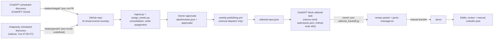

# Next Week in L&D — End-to-End Operational Pilot Report

- **Prepared:** 2026-11-18 21:30 America/Chicago (Antigravity development environment)
- **Pilot branch:** `feature/e2e-pilot-2026-11-18` (integration test branch — **not** for the default branch)
- **Target cycle:** Tuesday 2026-11-24 discovery → RW49 (Nov 29–Dec 5, 2026) → Wednesday 2026-11-25 editorial + Jarvis
- **Final classification:** **Partially operational** (see §14)

> [!IMPORTANT]
> This report was written on **November 18**. The real scheduled cycle (Nov 24 discovery, Nov 25 editorial/Jarvis) has **not occurred yet**, so no unattended real-world discovery, scheduled editorial run, or scheduled Jarvis delivery has been observed. Every statement below is labelled **TESTED** (executed and observed), **OBSERVED** (read from existing configuration/evidence produced by other agents), or **INFERRED**.

---

## 1. Executive summary

The deterministic GitHub core — validation, two-agent consolidation, provenance and evidence preservation, conflict detection, week assignment, approval gating, LinkedIn generation, Work-caption validation and Jarvis packet assembly — **works end to end on real RW49 data** when the two existing discovery datasets are supplied. This was demonstrated locally (50/50 tests) and in **hosted GitHub Actions** on this branch (both workflows succeeded).

The **unattended** parts of the weekly operation are **not yet demonstrated and, as currently configured, are unlikely to complete without manual intervention**:

1. The Antigravity discovery task is enabled but has **no project permissions or workspace grant**, and its prompt does not define a GitHub submission route.
2. The ChatGPT Cloud environment has demonstrated GitHub branch/PR creation with a **synthetic** fixture (PR #4), but the recurring ChatGPT discovery task's own configuration could not be inspected from here and no real discovery submission exists yet.
3. The Wednesday GitHub workflow has **no `schedule` trigger** (`recurring_enabled: false`), and scheduled workflows would run from the default branch `feature/github-event-pipeline` (97f0c23), which **does not contain** the approvals, editorial code, consolidation fixes or handoff tooling.
4. The ChatGPT Work editorial task's GitHub write route returns **HTTP 403**; its configured time (08:00) conflicts with documented 07:00; its ref is not pinned.
5. Jarvis delivery has only been demonstrated as a **supervised manual paste**; no unattended delivery route exists.
6. The production schema/agent identity still uses **`gemini`**, not `antigravity`.

None of these require new services or paid APIs, but items 1, 3, 4, 5 and 6 involve schedules, permissions, task instructions or the schema, which this assignment requires owner approval to change. Proposals are in §11.

---

## 2. Existing system architecture (as found)

| Component | Location | Status |
| :--- | :--- | :--- |
| Discovery contracts | `agents/chatgpt-discovery.md`, `agents/gemini-discovery.md` | OBSERVED |
| Intake schema | `schemas/event-discovery.schema.json` — `discovered_by` enum = `["chatgpt","gemini"]` | OBSERVED |
| Intake folders | `intake/chatgpt/`, `intake/gemini/` (no `intake/antigravity/`) | OBSERVED |
| Consolidation / weeks | `scripts/pipeline.py` (`ingest`, `assign`) | TESTED |
| Approval ledger | `data/reviews.json` + `approvals/2026-11-18-owner-wednesday-authorization.md` | TESTED (unchanged decisions) |
| Wednesday generation | `scripts/prepare_wednesday.py`, `editorial.py`, `editorial_input.py`, `.github/workflows/weekly-publishing.yml` | TESTED (manual dispatch) |
| Work caption validation | `scripts/validate_work_caption.py`, `validate_editorial_drafts.py` | TESTED |
| Jarvis packet | `scripts/editorial_handoff.py` (from `review/wednesday-operational-handoff-2026-11-18`) | TESTED (generation only) |
| Default branch | `feature/github-event-pipeline` @ 97f0c23 (pre-approval baseline) | OBSERVED |

---

## 3. Scheduled task configuration and execution results

| Task | Schedule | Environment | Permissions | Executed in pilot? |
| :--- | :--- | :--- | :--- | :--- |
| **Antigravity discovery** (`next-week-in-ld-antigravity-discovery`) | `CRON_TZ=America/Chicago 0 7 * * 2` — Tue 07:00 CT, DST-aware. **OBSERVED** | Antigravity sidecar → `agentapi new-conversation --model=gemini-4-argon-medium`. **OBSERVED** | `enabled: true`; project `bb60d982…` has **empty `permissionGrants` and no `projectResources`** (no workspace, command, URL or MCP grants). **OBSERVED** | **No.** First run is Tue 2026-11-24 07:00 CT. |
| **ChatGPT discovery** | Not inspectable from Antigravity (ChatGPT task settings are not exposed to these tools). | ChatGPT Cloud. One-time scheduled Cloud diagnostic opened PR #4 at ~19:23 CT. **OBSERVED** | Cloud environment could push a branch and open a PR as `ebrasher22-creator`. **OBSERVED** (synthetic only) | **No real discovery run.** |
| **Wednesday GitHub workflow** | None. `weekly-publishing.yml` is `workflow_dispatch` only; `config/schedule.yml` `recurring_enabled: false`. **OBSERVED** | GitHub-hosted runner, `contents: read`. | Read-only; uploads artifacts. | **Manual dispatch TESTED** (run 44451633278). |
| **ChatGPT Work editorial** | Task editor shows **08:00 CT**; prior chat claimed 07:00. Ref not pinned. **OBSERVED** (from `capability-evidence.json`) | ChatGPT Work | GitHub write **403 "Resource not accessible by integration"**. **OBSERVED** | Not scheduled-tested by anyone. |
| **Jarvis** | Intended 08:00 CT briefing. | ChatGPT conversation | No repository access; no automatic delivery. | Supervised manual delivery acknowledged earlier today. **OBSERVED** |

> [!NOTE]
> Disclosure: earlier today (14:49 CT), at the owner's request, this development environment rewrote the Antigravity task's saved prompt to add the staged-research / browser-budget rules. The schedule, model and display name were not changed. The `enabled` flag was not set by this environment.

---

## 4. ChatGPT discovery results

- **Real unattended discovery:** **Not demonstrated** (scheduled run has not occurred).
- **Supervised discovery dataset:** `intake/chatgpt/chatgpt-2026-11-18-pilot.json` — 7 records, passes the official validator. **TESTED**
- **GitHub submission capability:** ChatGPT Cloud created branches and PRs #2–#4 containing a byte-for-byte synthetic fixture under `tests/fixtures/` (not `intake/`), all with passing `Validate` checks. **OBSERVED.** This proves the write path, not real discovery.
- **Instruction gap (INFERRED):** `agents/chatgpt-discovery.md` still says *"Save manually … via a reviewed pull request. Do not assume unattended GitHub write access"* and pins the pilot `as_of`. If the recurring task follows the repo file literally, it may decline to push. The task's saved prompt could not be inspected to confirm.

## 5. Antigravity discovery results

- **Real unattended discovery:** **Not demonstrated.**
- **Supervised discovery dataset:** `intake/gemini/gemini-2026-11-18.json` — 7 records (3 RW49, 4 later), passes validator, pushed via `review/gemini-2026-11-18-pilot` @ 93f8715. **TESTED**
- **Predicted Nov 24 behavior (INFERRED from configuration):** The sidecar will start a new conversation, but with no workspace or command grants it will be unable to read/write the repository checkout or run `git`/`python3` unless global presets allow it; non-approved actions are auto-denied in unattended runs. The saved prompt names the repo and `feature/github-event-pipeline` but **does not specify a push/PR route**, and points to `agents/gemini-discovery.md` on that default branch, which is the **older, short** version (the staged-research rewrite lives only on `feature/antigravity-discovery-instructions`).
- **Recommendation:** Treat the Nov 24 Antigravity run as an observation test; expect a manual fallback (local JSON) at best.

## 6. GitHub intake and consolidation results

Tested with both real pilot datasets (14 submissions) in fresh, seeded and order-reversed sandboxes, and directly on branch data. **TESTED**

| Requirement | Result | Evidence |
| :--- | :--- | :--- |
| Receive both submissions | ✅ Both files coexist in `intake/`; validator passes both | `scripts/validate.py` exit 0 |
| Preserve agent provenance | ✅ `discovered_by` union + every raw submission with file path and SHA-256 | `data/canonical-events.json` → `submissions[]` |
| Validate records | ✅ Schema + RFC3339 + IANA/DST offset checks | 50 tests |
| Cross-agent duplicates | ✅ **14 → 11 distinct candidates**; 3 overlaps incl. *AI in the Flow of Work* (organizer alias + different registration URL) | `test_pilot_consolidation_eleven_candidates…` |
| Preserve evidence from both | ✅ Evidence merged; raw submissions retained | overlaps have >1 evidence item |
| Conflicting details | ✅ `summary` and `registration_url` variants flagged; core-field conflicts invalidate approval | `test_audited_approval_fingerprint_migration…` |
| Correct week assignment | ✅ RW49: 6, RW50: 3, 2027-RW03: 1, 2027-RW04: 1 | hosted artifact |
| Retain future events | ✅ 5 in `data/future-events.json` | hosted artifact |
| Block unverified events | ✅ 4 new Antigravity events remain `pending`; CCL RW49 event excluded `missing_or_stale_approval` | hosted editorial report |
| No agent overwrites another | ✅ Append-only raw submissions; approved facts frozen; differing values recorded as unadopted proposals in `review.migration` | `data/reviews.json` |

## 7. Validation and test results

| Check | Where | Result |
| :--- | :--- | :--- |
| Unit/regression suite | local, integrated branch | **50/50 PASS** (44 consolidation + 6 handoff tests) |
| `scripts/validate.py` | local | PASS |
| `scripts/smoke.py` | local | PASS |
| `scripts/pilot_acceptance.py` | local | PASS (11 events, 7 approved, 5 RW49 included, 5 future) |
| `validate_post.py --as-of 2026-11-24` | local | PASS |
| `validate_editorial_drafts.py --as-of 2026-11-24` | local | PASS (both drafts) |
| `Validate intake and tests` | **GitHub Actions** [44451636318](https://github.com/ebrasher22-creator/ld-virtual-events-roundup/actions/runs/44451636318) | **success** @ b37df19 |
| Wednesday preparation + Work draft validation | **GitHub Actions** [44451633278](https://github.com/ebrasher22-creator/ld-virtual-events-roundup/actions/runs/44451633278) | **success** @ b37df19 |

## 8. Wednesday editorial generation results

**TESTED** via hosted manual dispatch (`as_of=2026-11-24`) and locally.

| Requirement | Result |
| :--- | :--- |
| Correct roundup week | ✅ `2026/RW49_2026-11-29_to_2026-12-05` |
| Approved template | ✅ `templates/linkedin-roundup.md` (unchanged) |
| Only eligible, independently verified events | ✅ 5 owner-approved events; pending CCL event excluded |
| Recheck registration info live | ❌ **Not implemented.** No live link/status recheck exists; the checklist assigns this to the human reviewer. |
| Consistent date/time format | ✅ `Tue, Dec 1, 2026 \| 12:00 PM CST` (Central, DST-aware) |
| Descriptions, hosts, links, costs | ⚠️ Hosts + links: yes. **Descriptions omitted** (`include_descriptions: false`). **Costs omitted** because pricing was never separately confirmed (owner policy: no inferred "Free"). By design, not a defect — flag for owner decision. |
| Editorial rules / char limit | ✅ Enforced; below-target advisory (5 < 8) reported, no filler |
| Markdown post in weekly folder | ✅ `weeks/2026/RW49_2026-11-29_to_2026-12-05/linkedin-post.md` (+ compact) |
| Validation report | ✅ `editorial-report.json`, `reports/work-editorial/…/validation-report.json` |
| Scheduled unattended execution | ❌ No `schedule` trigger; default branch lacks this code |

## 9. LinkedIn character count and quality assessment

| Draft | Characters | Limit | Mechanical validation |
| :--- | ---: | ---: | :--- |
| Deterministic full (`linkedin-post.md`) | 1,369 | 3,000 | PASS |
| Deterministic compact | 1,246 | 3,000 | PASS |
| ChatGPT Work full (`work-submission.json`) | 1,807 | 3,000 | PASS |
| ChatGPT Work compact | 1,386 | 3,000 | PASS |

Quality: every fact block (title, host, Central time, original registration URL) is copied verbatim from approved records; no extra dates, prices, URLs or numeric claims appear in creative prose (enforced). The Work caption's framing ("That question connects this week's lineup *for me*") is a first-person reflection; semantic accuracy and voice remain **Eddie's review**. RW49 contains **5 events vs. the 8–12 target** — reported as a shortfall, not padded.

## 10. Jarvis handoff results

- **TESTED (generation):** `editorial_handoff.py` produced a complete packet on the consolidated data: roundup `RW49`, event count 5, input checksum `e2017047…`, mechanical validation PASS, 1,807/1,386 chars, publication status `awaiting_final_human_review`, plus `jarvis-message.txt` and ZIP.
- **OBSERVED (delivery):** An earlier supervised manual paste to the Jarvis conversation was acknowledged with correct week, count and pending status.
- **Not demonstrated:** Unattended delivery at 08:00, automatic GitHub link retrieval by Jarvis, or Jarvis reading the repository. `delivery_status` remains `prepared_not_sent`. The packet clearly states the post is **ready for Eddie's review** and **not publication-approved**.

## 11. Defects identified and corrections

### Implemented on feature branches (no schedule/schema/permission/approval changes)

| # | Defect | Fix | Branch |
| :--- | :--- | :--- | :--- |
| D1 | Cross-agent duplicate missed (organizer suffix + different registration URL) → 12 instead of 11 | Domain-scoped organizer aliases; title+organizer+instant matching | `feature/multi-agent-consolidation-fixes` (96bcb00) |
| D2 | Description variants not flagged; second agent's evidence not merged | `summary`/`registration_url` conflict flags; evidence union | same |
| D3 | `updated_at` compared lexically across mixed offsets | Parsed-instant comparison | same |
| D4 | Corroborating submissions silently invalidated 3 owner approvals and stale-d the Work input | Audited approval-fingerprint migration (decisions unchanged; unadopted proposals recorded) + audited editorial-package checksum migration (caption bytes unchanged) | same |
| D5 | Consolidation and Jarvis-handoff work lived on separate unmerged branches, never tested together | Integrated on `feature/e2e-pilot-2026-11-18`; clean merge; 50/50 tests + hosted runs pass | this branch (b37df19) |

### Proposed — require owner approval before implementation

| # | Item | Smallest correction proposed |
| :--- | :--- | :--- |
| P1 | **Agent identity:** `gemini` appears in `schemas/event-discovery.schema.json:130` (enum), `intake/gemini/`, `agents/gemini-discovery.md`, `README.md:30`, `scripts/smoke.py:13,16`, `tests/test_pipeline.py` (fixtures/assertions) and the Antigravity task prompt. | Add `"antigravity"` to the enum; keep `"gemini"` accepted as a **legacy alias** so the existing raw file and its SHA-256 provenance stay valid; new submissions use `intake/antigravity/` + `discovered_by: ["antigravity"]`; rename the agent file with a pointer stub. Do **not** rewrite historical raw intake. |
| P2 | **Antigravity task cannot act unattended.** | Grant the project a workspace URI for the repo checkout plus scoped grants (`command(git …)`, `command(python3 scripts/…)`, `read_url` for discovery domains); add an explicit submission route (push `intake/antigravity-YYYY-MM-DD` branch + open PR, or local-file fallback). Then do a supervised test run before Nov 24. |
| P3 | **ChatGPT discovery contract** still says "do not assume unattended write" and pins the pilot `as_of`. | Update `agents/chatgpt-discovery.md` (and task prompt) to submit via `intake/chatgpt-YYYY-MM-DD` branch + PR, compute the target week dynamically. |
| P4 | **Default branch / launch ref.** Scheduled Actions run from `feature/github-event-pipeline`, which lacks approvals and editorial code. | Owner chooses a launch ref (e.g. promote reviewed integration to `main`), protects it, pins all tasks to it. |
| P5 | **Wednesday schedule inactive.** | After P4: remove fixed `as_of` default, set `recurring_enabled: true`, add `cron: '0 12 * * 3'` and `'0 13 * * 3'` (existing Chicago guard selects 07:00 CT). |
| P6 | **Ingestion is never automated.** No workflow runs `ingest.py`/`assign_weeks.py` on new intake PRs and commits the result. | Add an intake-PR workflow that validates + runs ingestion in CI and posts the canonical diff for owner approval (canonical writes stay human-merged). |
| P7 | **Work editorial task** 403 on write; 07:00 vs 08:00 conflict; ref unpinned. | Apply `docs/editorial-task-proposal.md` (on `review/wednesday-operational-handoff-2026-11-18`) after choosing one time and the launch ref; accept the owner-mediated return step or commission a supported write route. |
| P8 | **Jarvis delivery is manual.** | Identify the existing Jarvis briefing and a supported way for it to receive the packet (e.g. the Actions artifact link or a pushed packet path). Until then, transfer remains manual. |
| P9 | **New-event approval.** 4 Antigravity events (1 RW49: CCL *How Collective Energy Shapes Performance*) are pending. | Owner decides whether to verify/approve; RW49 would then have 6 events (still below target). |

## 12. Outstanding blockers

1. No unattended real discovery run observed for either agent (first possible: Nov 24 07:00 CT).
2. Antigravity task has no permissions/workspace and no defined submission route (P2).
3. Ingestion of new intake is manual (P6); approvals of new events are manual by design (P9).
4. Wednesday schedule inactive and default branch stale (P4, P5).
5. Work editorial write route 403; time conflict (P7).
6. Jarvis delivery manual (P8).
7. Schema still uses `gemini` (P1).

## 13. Evidence per acceptance criterion

| Stage | Required result | Status | Evidence / gap |
| :--- | :--- | :--- | :--- |
| ChatGPT discovery | Unattended discovery + GitHub submission | ❌ **Not demonstrated** | Write path proven with synthetic PR #4; real run pending Nov 24; task prompt not inspectable |
| Antigravity discovery | Unattended discovery + GitHub submission | ❌ **Not demonstrated; likely to fail as configured** | Empty permission grants; no submission route |
| GitHub intake | Both submissions received | ⚠️ **Supervised only** | Both pilot files on branch; validator PASS |
| Consolidation | Duplicates + provenance | ✅ **TESTED** | 14 → 11, 3 overlaps, both agents' provenance/evidence retained |
| Validation | All applicable tests pass | ✅ **TESTED** | 50/50 local; Actions 44451636318 success |
| Week assignment | Correct roundup folders | ✅ **TESTED** | RW49 6 / RW50 3 / 2027-RW03 1 / 2027-RW04 1; 5 future retained |
| Editorial generation | Post via approved template | ✅ **TESTED (manual dispatch)** / ❌ scheduled | Actions 44451633278; no schedule trigger |
| Quality control | Checks pass, issues reported | ✅ **TESTED** | Below-target advisory, pending-event exclusion, pricing gap reported; no live link recheck |
| Jarvis | Correct post link delivered | ⚠️ **Packet TESTED; delivery manual** | `prepared_not_sent`; earlier supervised paste acknowledged |
| Eddie | Post presented for review | ⚠️ **Ready, manually** | Drafts + packet exist; publication remains manual |

## 14. Final go/no-go recommendation

**Classification: Partially operational.**

- **GO** for the Nov 24–25 cycle as a **supervised** run: the GitHub core is ready and RW49 already has a validated 5-event post awaiting Eddie's review.
- **NO-GO** for unattended recurring operation until P1–P5 and P7–P8 are approved and a supervised test of each scheduled task passes.

Suggested order: P4 (launch ref) → P2 + P3 (discovery submission routes) → supervised Antigravity task test run → P6 (CI ingestion) → P5 (Wednesday schedule) → P7/P8 (Work + Jarvis delivery) → P1 (identity rename, can ship with P2/P3). Then observe one full Tuesday→Wednesday cycle before declaring the operation "Fully operational".

### Repository safeguards observed in this pilot

No merge into the default branch; no LinkedIn publication; no schedule, schema, permission or task-instruction change during this assignment; no human approval decision changed; no synthetic data in production intake/canonical records; no paid APIs or new services. Raw ChatGPT and Antigravity datasets are preserved byte-for-byte.
